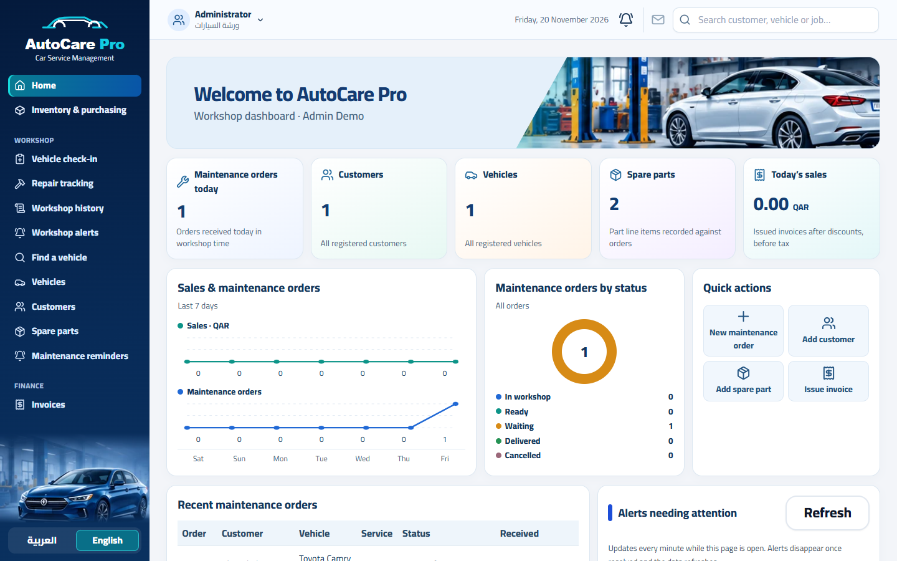
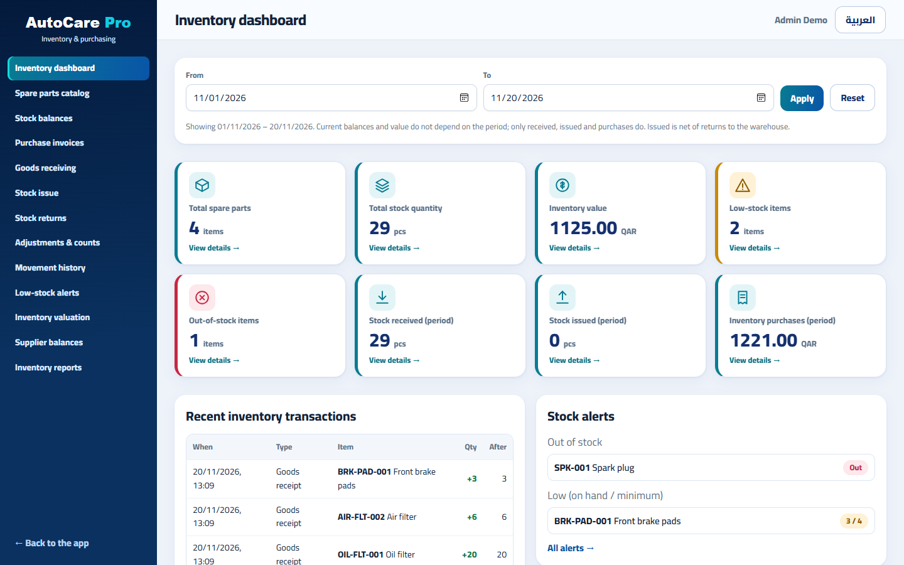
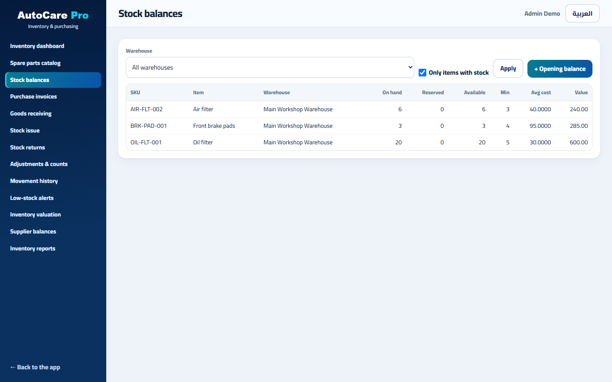
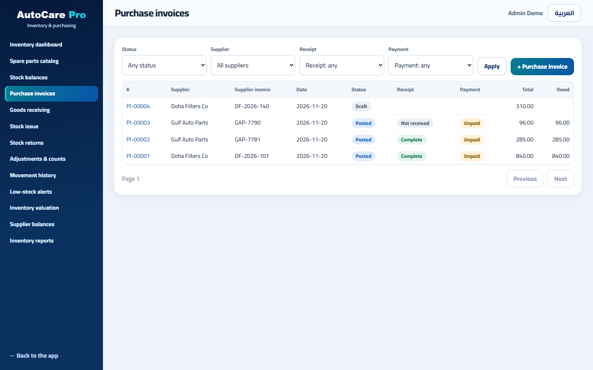
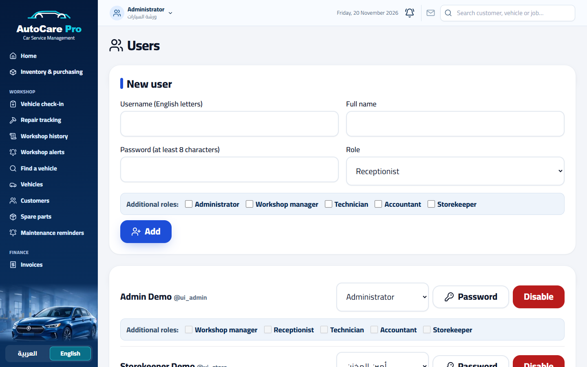
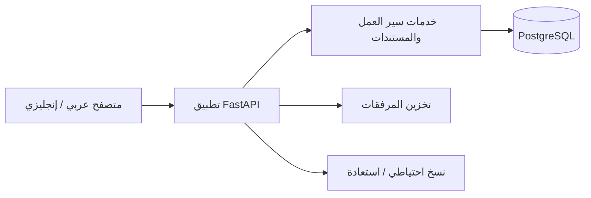

[English](README.md) · **العربية**

# AutoCare Pro

### إدارة الورشة من استقبال السيارة حتى التسليم، ومعها المخزن والمشتريات

AutoCare Pro تطبيق واحد (عربي / إنجليزي) يربط العملاء والمركبات وأوامر الصيانة وعروض الأسعار والفواتير والمدفوعات وفحص الجودة والتسليم، ومعه تطبيق مخزن ومشتريات لقطع الغيار. مصمَّم للتشغيل المحلي على Windows بدون إنترنت، مع إمكانية الوصول من الشبكة الداخلية عند ضبطه بأمان.

*كل اللقطات في هذه الصفحة مأخوذة من نسخة تجريبية معزولة ببيانات وهمية. لا توجد بيانات عملاء أو ورش حقيقية في أي صورة.*

## المميزات

| المجال | ما يقدمه |
|---|---|
| الاستقبال والسجلات | العملاء والمركبات وسجل الملكية واللوحات، حالة السيارة عند الاستقبال، الشكوى، وتاريخ الخدمة |
| تنفيذ العمل | أوامر الصيانة، توزيع الفنيين، عمليات الإصلاح، الفحص، ومتابعة التقدم |
| العروض والقطع | عروض الأسعار مع قرار لكل بند وإثبات إلزامي، الموردون، تركيب القطع وإرجاعها |
| المخزن والمشتريات | كتالوج قطع الغيار، الأرصدة، فواتير الشراء (مسودة ثم ترحيل)، استلام البضاعة جزئيًا أو كليًا، دفعات الموردين ومرتجعاتهم، صرف القطع لأوامر الصيانة، الجرد والتسويات، سجل حركات لا يُعدَّل، تنبيهات النقص، التقييم والتقارير |
| المالية | فواتير مسودة ومُصدَرة، دفعات مقدمة وجزئية، استردادات، إشعارات دائنة، مصروفات |
| التسليم وما بعده | فحص الجودة، شروط التسليم، استثناءات مسجلة، الضمان والمطالبات، والتذكيرات |
| الإدارة | ستة أدوار قياسية، **أكثر من دور للمستخدم الواحد** (الصلاحيات هي اتحاد صلاحيات أدواره)، صلاحيات من الخادم، سجل مراجعة، إعدادات، مرفقات، تقارير، ونسخ احتياطي واستعادة |

## لقطات الشاشة

### لوحة المخزن

ثمانية مؤشرات (٤ في الصف، ثم ٢، ثم ١ حسب عرض الشاشة)، مع فلتر للفترة (تطبيق / إعادة ضبط) ورسوم وتنبيهات.

### أرصدة المخزون

### فواتير الشراء

حالة كل فاتورة (مسودة / مُرحَّلة) وحالة الاستلام وحالة الدفع ظاهرة في القائمة.

### المستخدمون وتعدد الأدوار

تحت كل مستخدم مربعات "الأدوار الإضافية"، وكذلك في نموذج إضافة مستخدم جديد.

## كيف يعمل المسار

1. **الاستقبال:** معالج من خمس خطوات (العميل، المركبة، حالة السيارة، الشكوى، التأكيد).
2. **عرض السعر:** يُقفل بعد الإرسال. القرار لكل بند مع طريقة القرار وإثبات إلزامي. الموافقة تحجز مخزون المخزن، والرفض يفك الحجز.
3. **مصدر القطعة:** من المخزن، أو من العميل، أو شراء مباشر للأمر. لكل مصدر أثره الخاص على المخزون والتكلفة والضمان. القطعة غير المستخدمة ترجع للمخزن، أما المعيبة أو المستعملة فلا.
4. **التنفيذ وفحص الجودة:** عند فشل الفحص يعود الأمر إلى "قيد التنفيذ".
5. **التسليم:** لا يتم إلا إذا تحققت الشروط: القطع مركّبة أو مرتجعة، فحص الجودة ناجح، الحالة "جاهز"، فاتورة مُصدَرة ومدفوعة بالكامل، لا بنود غير مفوترة، ولا فاتورة مسودة. للمدير استثناء بسبب مكتوب يُسجَّل في المراجعة.

## قواعد المخزن والمحاسبة

- يزيد رصيد المخزون **عند الاستلام** فقط، وليس عند إدخال فاتورة الشراء.
- **سجل الحركات لا يُعدَّل:** التصحيح يتم بحركة عكسية، وليس بتغيير الحركة القديمة.
- **الإيراد** عند إصدار الفاتورة صافيًا من الإشعارات الدائنة.
- **تكلفة البضاعة المباعة (COGS)** تُحسب حسب مصدر القطعة.
- **المشتريات ودفعات الموردين ليست مصروفات** تشغيلية، فهي تغيّر المخزون وذمم الموردين.

الشرح الكامل في [دليل وحدة المخزن](app/docs/INVENTORY_MODULE.md).

## التثبيت على Windows

حزمة التثبيت الجاهزة (المثبّت، وبايثون وPostgreSQL المدمجان، والواجهة المجمّعة) **ليست داخل المستودع** بسبب حجمها. نزّل `AutoCare-Pro-Friday-Production-2026-11-20.zip` من [صفحة الإصدارات](https://github.com/AhmedHeiza123/AutoCare-Pro/releases)، فك الضغط، ثم شغّل `INSTALL.bat` ووافق على طلب الصلاحيات.

- **الترقية:** شغّل `INSTALL.bat` على الجهاز الذي عليه النسخة القديمة. البيانات تبقى، وتُحفظ نسخة من قاعدة البيانات أولًا في `backups\pre-upgrade`.
- لا تنسخ الملفات يدويًا فوق نسخة تعمل؛ الكود يحتاج تغييرات قاعدة البيانات التي يطبقها المثبّت (الإصدار الحالي `0012`).
- **خذ نسخة احتياطية** قبل الترقية على جهاز فيه بيانات حقيقية، واحتفظ بنسخة من `backend\.env` ومجلد `secrets`.
- الشهادة الافتراضية ذاتية التوقيع، فسيطلب المتصفح تأكيد المتابعة لأول مرة.

## البنية والتقنيات

التقنيات: React وFastAPI وSQLAlchemy 2 وPostgreSQL 15 وAlembic. الواجهة الرئيسية **مجمّعة (compiled) ومستعادة**، ولم يُعثر على مشروع JSX/TypeScript الأصلي. لذلك تُضاف التخصيصات (واجهة المخزن وصفحة الأدوار) كملفات مصدرية مستقلة في `app/frontend/inventory-src` وتُبنى بالأداة `app/frontend/tools/build_inventory_ui.py`.

## ما جُرِّب وما لم يُجرَّب

**جُرِّب:** 124 اختبار آلي للخادم نجحت كلها على قاعدة بيانات مؤقتة، منها السيناريو الإلزامي للمخزن (أ / ب / ج) بأرقامه، وتعدد الأدوار، والترحيلات `0011` و`0012` صعودًا وهبوطًا. وفحصت الشاشات في متصفح مدمج على نسخة معزولة. التقارير في [app/docs/qa-reports](app/docs/qa-reports).

**لم يُجرَّب:** متصفحات أخرى، واختبار الأحمال، وتثبيت نظيف على جهاز ثانٍ، وعرض مربعات الأدوار على الموبايل.

## ما لا يدّعيه المشروع

بوابة دفع إلكتروني، وإرسال WhatsApp أو SMS للعملاء، وأوامر الشراء، وتتبع الدفعات والأرقام التسلسلية وتواريخ الصلاحية، والمخزون متعدد الفروع، كلها **غير موجودة** حاليًا. لا يوجد ادعاء بأمان إنتاجي كامل أو خلو من الثغرات. اقرأ [SECURITY.md](SECURITY.md) و[ملخص المراجعة الأمنية](docs/SECURITY-REVIEW-SUMMARY.md) و[الفرق بين النشر والتشغيل](docs/PUBLICATION-VS-OPERATIONS.md).

## الوثائق

- [دليل المخزن والمشتريات](app/docs/INVENTORY_MODULE.md)
- [مرجع الـ API](docs/API-REFERENCE.md)
- [البنية المعمارية](docs/ARCHITECTURE.md)
- [الإعداد](docs/SETUP.md)
- [سجل التغييرات](docs/CHANGELOG.md)

## الترخيص

MIT. راجع ملف [LICENSE](LICENSE) وإشعارات الأطراف الثالثة في [THIRD-PARTY-NOTICES.md](THIRD-PARTY-NOTICES.md).

