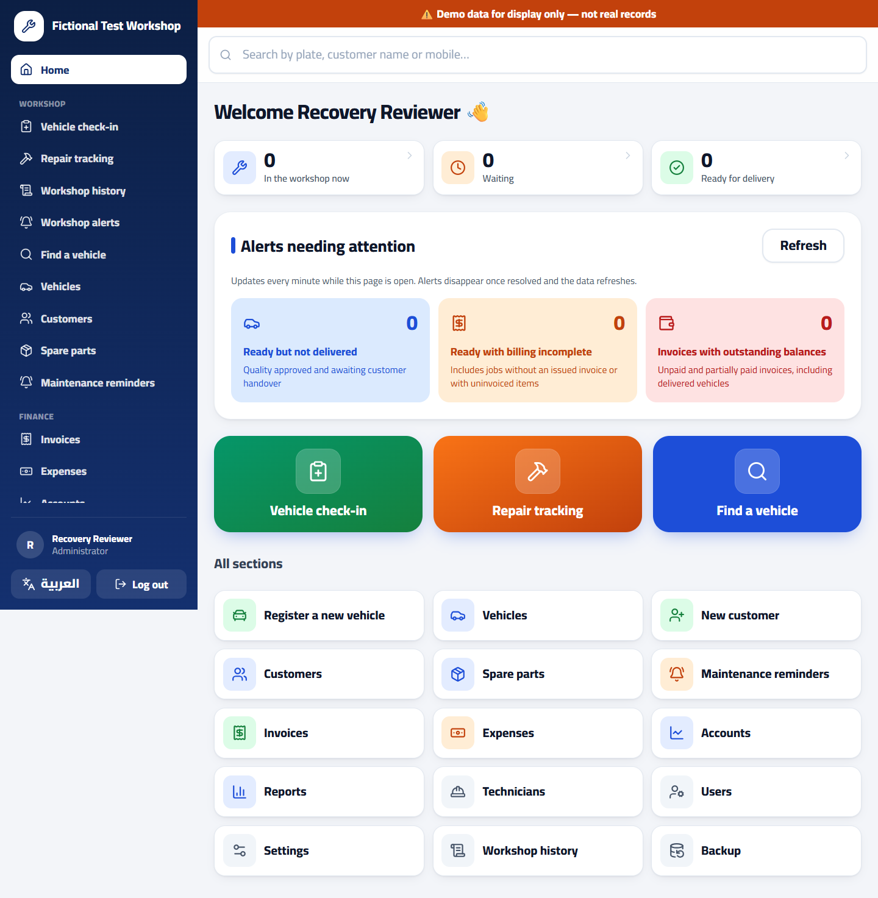
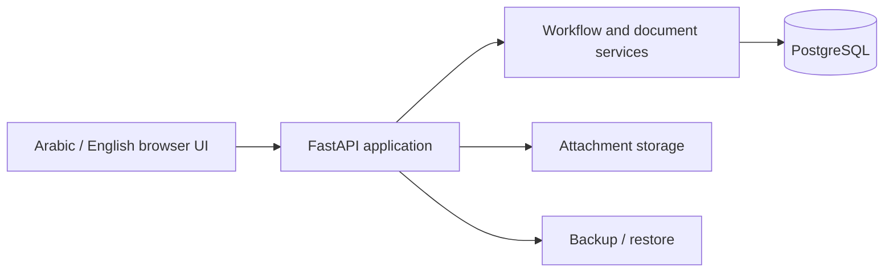

# AutoCare Pro

### Workshop operations, from vehicle check-in to delivery

AutoCare Pro connects customer and vehicle records, repair work, quotations, parts purchasing, billing, quality checks and delivery in one Arabic/English application. It is designed for local Windows operation, with controlled private-network access when configured securely.

**Current status:** a local source review candidate with a rebuildable **recovered compiled-JavaScript frontend**. The original JSX/TypeScript project was not located. The candidate preserves the interface and business logic, adds reproducible build tooling and includes documented security fixes. It has not been published or certified for production deployment.



*Verification screenshot with fictional fixtures. No customer or workshop production records are shown.*

## Features

| Area | Capabilities |
|---|---|
| Reception and records | Customers, vehicles, ownership/plate history, condition observations, complaints and service history |
| Workshop execution | Job cards, technician assignments, repair operations, inspections and progress tracking |
| Estimates and parts | Quotations, item-level approval evidence, suppliers, job-linked purchases, installation and returns |
| Finance | Draft/issued invoices, deposits, partial payments, refunds, credit notes and expenses |
| Delivery and aftercare | Quality checks, readiness, audited exceptions, warranties/claims and reminders |
| Administration | Five standard roles, server-side permissions, audit, settings, attachments, reports and recovery |

The repair catalog supports custom categories and Arabic and English names for each repair option. The job card uses the interface language when presenting those options. Labor charges continue to use the hours and hourly rate entered on the repair operation.

Parts purchasing is job-linked. A warehouse inventory system, payment gateway and outbound WhatsApp/SMS integration are not claimed. Approvals and payments are recorded business workflows.

## Architecture and stack



The stack combines React, FastAPI, SQLAlchemy and PostgreSQL. Bundle evidence identifies React 18.3.1, React Router/DOM 6.30.6, Remix router 1.23.4 and lucide-react 1.59.0. The complete original embedded dependency graph remains unavailable.

The **new** tooling pins Vite 8.3.8, Babel 8.1.2 and Playwright 1.62.1 separately from the embedded runtime. See [architecture](docs/ARCHITECTURE.md) and [recovery details](docs/FRONTEND-RECOVERY.md).

## Build and run

Requirements: Node.js 24.11+ and pnpm 11.25.0; Python 3.12 and a dedicated PostgreSQL development database for the backend. The reviewed environment used Windows, Node 24.22.1 and PostgreSQL 15.19.

From `app/frontend`:

```powershell
pnpm install --frozen-lockfile --ignore-scripts
pnpm test
pnpm build
```

The build uses recovered source, compiled CSS and local fonts. Generated `dist`, dependency folders and raw test evidence are excluded from this GitHub source candidate. The preserved `recovery/original-dist` is a test/provenance baseline and must not be deployed.

Prepare a **separate development backend** using [SETUP.md](docs/SETUP.md), then select its origin explicitly:

```powershell
$env:AUTOCARE_API_TARGET = 'http://127.0.0.1:18080'
pnpm dev
```

Open `http://127.0.0.1:5173`. Dev and preview bind to localhost and require an explicit backend origin. After building, FastAPI can serve `app/frontend/dist` from the same origin as its API. Complete first-admin setup locally before network access. No configured `.env`, password, database or bundled runtime is included.

## Verification

The final candidate passed **11 frontend tests, 6 focused backend tests and 13 browser checks**. Eleven browser cases compare text/screenshots with the original; additional flows exercise development login/language switching and logout/account isolation across tabs.

An isolated PostgreSQL smoke check applied migrations, exercised setup/session/CSRF/customer endpoints and logged in through the rebuilt UI. It reused installed dependency files; a fresh backend dependency installation and full business/recovery suite remain unverified. See [VALIDATION.md](docs/VALIDATION.md).

## Security status

The review fixed first-admin network access, public restore-progress disclosure, account-bound draft/cache retention and cross-tab session display. Earlier demo-password and developer-tools-path fixes are retained.

**Open operational/tooling items remain:** a High upstream build-tool advisory; router applicability/migration work; incomplete exact-version inventory; LAN HTTPS requirements; and plaintext pre-restore artifacts. They are not all automatic blockers to sharing this experimental source. Owner rights are confirmed and available notices have been expanded; actual publication still requires explicit approval. Read [publication versus operation](docs/PUBLICATION-VS-OPERATIONS.md), [SECURITY.md](SECURITY.md) and the [review summary](docs/SECURITY-REVIEW-SUMMARY.md). No production-security or zero-vulnerability claim is made.

## Documentation

- [Setup](docs/SETUP.md) and [architecture](docs/ARCHITECTURE.md)
- [API inventory](docs/API-REFERENCE.md)
- [Recovery and reconstruction limits](docs/FRONTEND-RECOVERY.md)
- [Verification](docs/VALIDATION.md) and [security changes](docs/CHANGELOG.md)

Staff manuals remain in `app/docs/`; some old references are historical. Arabic guidance is in [ابدأ-هنا.md](ابدأ-هنا.md).

## License

[MIT](LICENSE) applies to original code/documentation the owner confirmed they may publish. Fonts and embedded libraries retain their terms. Six exact-package texts and four additional family-reference MIT texts are included under `third_party/`; [third-party notices](THIRD-PARTY-NOTICES.md) explain evidence and unknown versions. The copyright label remains `AutoCare Pro contributors`; choosing a different display name is optional, not a newly imposed publication blocker.
