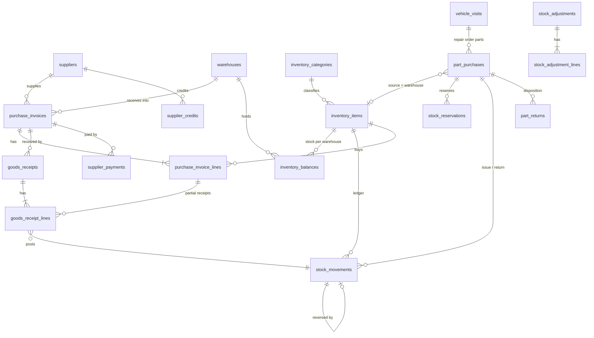

# AutoCare Pro — Inventory, Procurement & Financial Integration (backend release 0011)

Status: **backend implemented and tested; frontend NOT implemented** (no editable frontend source exists — see §9).
Nothing in this release is deployed automatically: it ships as a separate package and needs the database migration `0011`.

## 1. Verified findings of the audit (before any code was written)
* Stack: FastAPI + SQLAlchemy 2 + PostgreSQL, Alembic (10 migrations, head `0010`), Windows services `AutoCarePG` / `AutoCarePro`, offline; one worker process.
* `PartPurchase` (table `part_purchases`) is a *per-job* purchase record. It is referenced by quotations (`quotation_items.part_id`), invoices (`invoice_items.part_id`), returns (`part_returns`), warranties and all profit/COGS code (`accounting.py`, `finance.py`, `reports.py`). It has **no** warehouse concept. It was therefore **extended, not replaced**.
* COGS = Σ(invoice item qty × `part_purchases.unit_cost`) minus billed units later returned. Anything that sets `unit_cost` correctly (here: the weighted-average issue cost) flows into every existing report unchanged.
* `suppliers` already exist and are reused (no second supplier master). Attachments (`attachments`) are reused for the supplier-invoice scan (`owner_type = "purchase_invoice"`).
* Roles/permissions are seeded from `core/security.py` at start-up; new permissions are added to existing roles automatically on the next start.
* Backups are full `pg_dump` archives, so new tables are included automatically; restore re-runs Alembic when the archive is older (`needs_upgrade`).
* The running service does **not** run migrations on start; only the installer's upgrade path does (after taking a database copy).

## 2. Design
### 2.1 Entity relationship diagram

### 2.2 New tables (migration `0011_inventory.py`, additive)
`inventory_categories`, `warehouses` (default row "Main Workshop Warehouse / المخزن الرئيسي للورشة"), `inventory_items`, `inventory_balances` (PK item+warehouse: `on_hand`, `reserved`, `value`, `last_cost`), `stock_movements` (append-only ledger), `stock_reservations`, `purchase_invoices`, `purchase_invoice_lines`, `goods_receipts`, `goods_receipt_lines`, `supplier_payments`, `supplier_credits`, `stock_adjustments`, `stock_adjustment_lines`.
Changed (additive): `part_purchases` + `source` (`direct` default | `warehouse` | `customer`), `inventory_item_id`, `warehouse_id`, `issued_qty`; `unit_cost` widened 2 → 4 decimals (values preserved); `part_returns` + `disposition` (`supplier` default | `warehouse` | `defective` | `used`). No table is dropped or rewritten; existing rows become `source = 'direct'` / `disposition = 'supplier'` = exactly the old behaviour.
### 2.3 Integrity enforced by the database itself
* Ledger `stock_movements`: trigger rejects UPDATE/DELETE; `reverses_id` UNIQUE (one reversal per movement); one `OPENING` per item/warehouse; unique `idempotency_key`.
* `inventory_balances`: `on_hand >= 0`, `reserved >= 0`, `reserved <= on_hand`, `value >= 0` (the DB refuses overselling whatever the application does).
* Unique: SKU, barcode, (brand, manufacturer part no), one active reservation per job part, one default warehouse, supplier invoice number per supplier (non-cancelled), category name per parent.
* Posted purchase invoices and their lines are immutable (only `qty_received`/`received_value` move); supplier payments and credits can never be edited or deleted.
* Every monetary column is `Numeric` (money 2 dp, unit cost 4 dp, quantity 3 dp, value 4 dp).

## 3. Business rules
### 3.1 Three separate events (never one expense)
| Event | Effect |
|---|---|
| Supplier invoice **posted** | liability to the supplier; no stock change |
| Goods **received** (full or partial) | stock + inventory asset value increase at the invoice's net cost (line and invoice discount applied; tax is recoverable, not capitalised) |
| Supplier **paid** | liability decreases; no stock change; **not** an operating expense |
| Stock **issued** to a repair order | stock − at weighted-average cost; cost frozen on the job part → COGS when the job is billed |
Valuation: perpetual weighted average per (item, warehouse): out-cost = value × qty / on_hand (last unit takes the remaining value, no rounding dust); returns to the warehouse go back at the cost they left with.
### 3.2 Purchase invoice: `draft → posted → cancelled`; receipt status `none → partial → full`
Draft editable/deletable; posting makes it immutable. Receipts only on posted invoices; partial receipts; over-receipt refused; the receipt that completes a line takes the exact remaining value (the parts add up to the net line value to the cent). A receipt can be reversed only while that stock is untouched; an invoice with receipts, payments or credits cannot be cancelled.
### 3.3 Repair-order part sources (`part_purchases.source`)
* **A — warehouse** (`POST /api/jobs/{id}/parts/warehouse`): availability checked on add (no deduction, no reservation — also not by a quotation). Status mapping reuses the existing flow: `ordered`/`purchased` = **reserved** (needs customer approval when a quotation was sent), `received` = **issued** (stock leaves, historical cost recorded; also approval-gated), `installed` = installed (issues automatically if not yet issued), `cancelled` = reservation released (refused once issued: return it instead). Customer approval of a quotation reserves stock for the approved warehouse parts (a shortage is reported as `stock_warnings`, never blocks the customer's decision); rejection releases it; cancelling a job releases all reservations and is refused while parts are issued-but-not-installed. A warehouse part is billable only after it was issued (its cost is only then known). Issue is idempotent (never twice).
* **B — customer-supplied** (`POST /api/jobs/{id}/parts/customer-supplied`): no stock, no supplier, cost 0, price 0, no parts revenue; labor billed normally; the line stays on the repair order (and invoice as 0.00). No part warranty unless stated explicitly.
* **C — direct purchase** (existing `POST /api/jobs/{id}/parts`): unchanged; never touches the warehouse.
### 3.4 Returns (`POST /api/parts/{id}/return-to-warehouse`)
`unused` → back to sellable stock at the cost it left with and COGS is reduced; `defective` / `used` → **not** restocked, the cost stays with the job (loss). Supplier-type returns (existing endpoint) are refused for warehouse parts. Credit to the customer remains a credit note (existing flow).
### 3.5 Concurrency & idempotency
Every posting locks the balance row (`SELECT … FOR UPDATE`) before reading it, in a fixed order; replays with the same `Idempotency-Key` return the first result. Tested with real parallel sessions.

## 4. API (new, all under `/api`, existing authentication and CSRF)
`inventory.read` — GET `/inventory/{categories,warehouses,items,items/{id},balances,movements,low-stock,dashboard,available}`; `inventory.write` — POST/PATCH `/inventory/{categories,items}`; `inventory.adjust` — POST `/inventory/{opening-balances,adjustments,counts,transfers,supplier-returns,warehouses}`, POST `/inventory/movements/{id}/reverse`; `inventory.costs` — GET `/inventory/valuation` and all cost/value fields; `purchasing.read/write` — `/inventory/purchase-invoices` (+ `/post`, `/cancel`, `/receipts`, `/payments`), `/inventory/receipts` (+ `/reverse`), `/inventory/supplier-balances`. Repair order (`parts.write` [+ `inventory.read`]): POST `/jobs/{id}/parts/warehouse`, `/jobs/{id}/parts/customer-supplied`, `/parts/{id}/return-to-warehouse`; `part_out` now also returns `source`, `inventory_item_id`, `warehouse_id`, `issued_qty`, `reserved_qty`.
Roles: admin/manager all; **storekeeper (new)** stock + purchasing, no costs; accountant costs + purchasing; receptionist/technician read-only (see availability and selling price, no cost).

## 5. Financial integration
`GET /api/reports/financial-summary` keeps every old key and adds: `parts_revenue_{warehouse,direct,customer_supplied,manual}`, `cogs_{warehouse,direct,customer_supplied}`, `inventory_purchases` (posted, ex-tax, accrual), `inventory_received_value`, `inventory_asset_value`, `supplier_payments` (cash), `supplier_outstanding`, `net_cash_flow`, `basis` (accrual vs cash). Purchases and supplier payments are never added to `operating_expenses`. Worked examples are executed as tests: buy 20 × 30 (stock 600, expense 0); use 2 × 50 (revenue 100, COGS 60, parts profit 40, stock 18 / 540); customer-supplied (parts revenue 0, labor 40); direct purchase 90/140 (profit 50, no warehouse movement); no double counting on a mixed job.
Reports (same export conventions, Arabic/English, CSV/XLSX): inventory-stock, inventory-valuation, low-stock, out-of-stock, stock-movements, inventory-adjustments, fast-moving, slow-moving, purchases-by-supplier, supplier-invoices, supplier-balances, supplier-payments (cash basis), job-parts-consumption, parts-profit-by-source.

## 6. Migration strategy, deployment, rollback
**Deploy (supported path):** make a backup in the app (Backup page), then run `INSTALL.bat` from the new package on the production computer — the installer saves a database copy to `backups\pre-upgrade`, copies the files, runs `alembic upgrade head` (applies `0011`) and starts the services; data is kept. **Do not copy the new backend over a running installation and restart the service without migrating**: the code expects the new columns.
**Verify:** `/health` ok; sign in; Backup page → "verify" the new backup; open a job → parts; Reports list shows the inventory reports.
**Rollback:** (1) stop `AutoCarePro`; (2) restore the previous package files; (3) restore the pre-upgrade copy — either the app's restore from the backup made before upgrading, or `pg_restore` of `backups\pre-upgrade\autocare-*.dump` into a new database; or (4) `python -m alembic downgrade 0010` — **destroys all inventory data** (tested: existing parts survive, unit costs keep their values). Backups made after the upgrade need this version to restore.

## 7. Tests (run `backend\tests\run_tests.ps1` — temporary throw-away PostgreSQL, ~2.5 min)
113 tests in total (see `QA_REPORT_2026-11-19.md`), all executed and passing; the original 68 are: 35 financial-audit tests (existing invoice/COGS/report behaviour preserved) + 32 inventory tests: master-data uniqueness; multi-line purchase; receive; partial receipts exact to the cent; duplicate receipt/payment/issue; supplier balance independent of receipts; weighted-average valuation; ledger append-only and DB-level oversell refusal; adjustments, counts, transfers, reversals; opening balance; supplier return + credit; quotation does not deduct, approval reserves, rejection and job cancellation release; issue once; insufficient stock everywhere; Examples 1–4; unused vs defective returns; **parallel sessions cannot reserve/issue the last unit or double-post a receipt**; reports, exports and permissions (cost hiding); migration `0010 → 0011 → 0010 → 0011` with existing data; `pg_dump`/`pg_restore` round trip of all new tables.

## 7. Known limitations
No general-ledger/journal (profit uses job COGS + recorded expenses); purchase-price variance on supplier credits is not posted; purchase tax is treated as recoverable (not capitalised); defective parts have no quarantine location or supplier-claim tracking (cost stays with the job); no landed-cost allocation of freight; no serial/batch/expiry tracking; no vehicle-compatibility search (stored as optional text list); job-part quantities carry 2 decimals; a warehouse part is billed only after issue; concurrent edits rely on row locks, tested with 2 sessions.

## 8. Frontend (implemented as a standalone module, no Node required)
The 12 screens are a separate, readable ES-module application served at `/inventory.html` (sources in `frontend/inventory-src/`, published to `dist/assets/inventory/` by `python frontend/tools/build_inventory_ui.py`). Arabic/English, RTL/LTR, same visual identity, phone-friendly, no inline script/style (works under the existing CSP), text always inserted as text (no HTML injection), CSRF + `Idempotency-Key` on every write.

| Screen | Route (`/inventory.html#…`) |
|---|---|
| Dashboard (KPI cards open filtered views) | `/dashboard` |
| Spare-parts catalog (+ categories, SKU/barcode) | `/items` |
| Stock balances (+ opening balance) | `/balances` |
| Supplier purchase invoices (draft → post → receive → pay → attachments) | `/purchases`, `/purchases/new`, `/purchases/<id>` |
| Goods receiving (open lines, partial receipts, reversal) | `/receiving` |
| Stock issue / reserve to repair orders | `/issue` |
| Stock returns (unused → restock; defective/used → no restock) | `/returns` |
| Adjustments, physical count, warehouse transfer, supplier return | `/adjustments` |
| Movement history (+ reversal of manual movements) | `/movements` |
| Low-stock alerts (→ draft purchase invoice) | `/low-stock` |
| Valuation / supplier balances | `/valuation`, `/suppliers-balance` |
| Reports (14 reports, view in the existing report viewer, Excel/CSV) | `/reports` |
| Part source on a repair order (From warehouse / Customer supplied / Direct purchase) | `/job/<repair-order-id>` |

Screens and actions follow the user's permissions (`/api/auth/me`); the server enforces them independently (verified: a technician gets 403 on invoices and valuation).

### Integration with the existing (compiled) application
`frontend/inventory-src/integration.js` (loaded by one `<script type="module">` tag that the build script adds to `dist/index.html`) does two things only, and never throws: (1) adds an "Inventory & purchasing" link to the main sidebar; (2) on a repair-order page under the "Spare parts" tab adds three buttons (From warehouse / Customer supplied / Direct purchase) that open `/inventory.html#/job/<id>`. The existing parts list already shows source, returned quantity, cost and profit because those fields come from the backend. If the compiled app's markup changes, the integration simply does nothing and the standalone page remains fully usable.

### Honest limitations of the frontend
It is **not** built from the original React source (which is not in the repository); the integration is DOM-based, not a native React component. Tested in a browser pane (Edge/Chromium) against a throw-away server and database with seeded data — receiving (partial), issue, return, adjustment, low-stock → draft invoice → post → payment, dashboard/valuation reconciliation, 28 report exports, Arabic/RTL, phone width, and restricted roles. Not tested: Safari/Firefox, printing, very large catalogs (lists are paginated), warehouse transfer between two warehouses (needs a second warehouse), physical-count tab and supplier-return tab were not exercised by hand (covered by backend tests). Some stored names (item/part names) appear in the language they were entered in.
