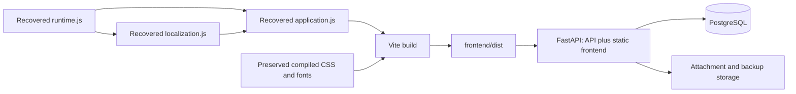

# Architecture of the recovered project

AutoCare Pro remains a modular monolith: a same-origin browser UI, FastAPI/SQLAlchemy backend, PostgreSQL database and local attachment/backup storage. The recovery changed the frontend authoring/build layout, not backend business rules.

The arrows between recovery modules describe dependencies, not the original component hierarchy. The application uses React 18.3.1 and embedded libraries; bundle headers identify React Router/React Router DOM 6.30.6, Remix router 1.23.4 and lucide-react 1.59.0. Query/cache code also remains embedded. Exact versions for every original dependency cannot be reconstructed reliably from this bundle alone.

New tooling is pinned separately: Vite 8.3.8, Babel parser/generator/traverse 8.1.2 and Playwright 1.62.1. These versions do not claim to reproduce the original build toolchain. No React refresh/JSX/Tailwind authoring pipeline was recovered.

Retained third-party code is not confined to runtime.js: the recovered application module also includes browser QR generation/shortest-path code matching qrcode/dijkstrajs families. Their attribution is now recorded separately; exact embedded versions are not asserted. Query/cache code is identified at TanStack Query family level.

During local development, Vite serves the source and proxies `/api` and `/health` only after `AUTOCARE_API_TARGET` explicitly selects a backend origin. Production FastAPI serves the rebuilt `app/frontend/dist` and its API from the same origin. HTTP session cookies and CSRF behavior are retained.

Backend modules under `app/backend/app/api/` cover authentication, customers/vehicles, jobs, quotations, parts, billing/finance, quality/delivery, warranty/reminders, reporting/search, settings/audit, attachments and backup/restore. Database schema history is in the ten Alembic migrations. The API inventory is in [API-REFERENCE.md](API-REFERENCE.md).

The GitHub candidate includes backend code, recovered frontend source, immutable baseline evidence, manuals, selected fictional screenshots and tests. It excludes generated dist, bundled runtimes, databases, private configuration, raw evidence, caches and node_modules. Build the UI before serving it through FastAPI; this is not an installer.

Security additions include `src/security/session-privacy.js`, a hash-pinned provider override, loopback-only bootstrap and filtered public restore status. These are deliberate fixes; the remaining original structure stays under preservation checks. See [security summary](SECURITY-REVIEW-SUMMARY.md).
